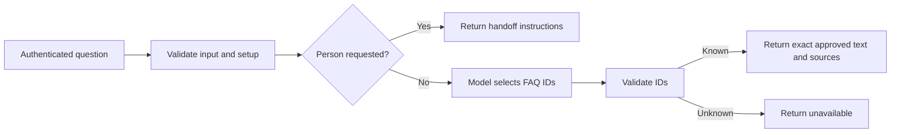

# Build a chatbot that returns only approved answers

A visitor asks when support opens. A model may help find the right FAQ, but it should not invent your hours, refund policy or an action that never happened. This template gives the model one job: choose existing article IDs. The workflow supplies the approved answer text.

## Watch it work in two minutes

From the [cloned library](README.md), with Node.js 22 or later:

```sh
node walkthroughs/run-workflow-demo.cjs faq
```

The command runs the exported **Prepare Request** and **Validate Model Output** Code nodes. It changes the disabled configuration only in memory and substitutes clearly fictional provider responses. It does not call Anthropic or start a webhook.

| Demonstrated case | Result | Why it matters |
|---|---|---|
| Unconfigured export | HTTP 503, `setup_required` | Imported examples cannot immediately answer visitors. |
| Fictional model selects `hours` | HTTP 200, `answered_from_approved_faq` | The returned text exactly matches the reviewed FAQ record. |
| Visitor sets `requestHuman: true` | HTTP 200, `human_handoff` | The workflow bypasses the model and explains the support route. |
| Fictional model selects an invented policy ID | HTTP 502, `unavailable` | An unknown answer is rejected instead of shown. |

The fictional answer is “Our fictional demonstration support team is available Monday through Friday, 09:00 to 17:00 UTC.” It is test content, not Benian's support promise.

## Follow the decision



`contactCreated` stays `false` in every successful response. A handoff instruction does not create a ticket or contact a staff member. Add and test that separate process if your business needs it.

## Put it into your operation

Import [the workflow](../approved-faq-chatbot.json), then follow [the setup guide](../approved-faq-chatbot.md). Have the person responsible for your policies approve every answer and source link. Put authentication on a server-side endpoint; never expose its secret in the visitor's browser.

Before launch, test your own questions, ambiguous wording and attempts to override the instructions. A model can choose a valid but irrelevant FAQ. This demo checks the answer boundary, not selection accuracy or production latency. Measure handoff completion separately from answered requests.

For a business-specific knowledge source, escalation process and operational checks, see [Benian's chatbot implementation approach](https://benian.ai/industries/enterprise/ai-chatbot?utm_source=github&utm_medium=referral&utm_campaign=automation_templates&utm_content=faq_walkthrough).
