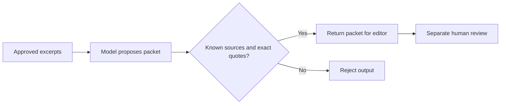

# Make AI-generated content easier to check before publication

A useful editorial automation keeps evidence attached to its ideas. This template accepts a topic and reviewed source excerpts, then returns a packet an editor can inspect. It does not publish an article.

## Watch a valid and an invented quote

From the [cloned library](README.md), with Node.js 22 or later:

```sh
node walkthroughs/run-workflow-demo.cjs editorial
```

The runner executes the exported preparation and validation Code nodes. A fictional model response stands in for the paid API call. The only source is this invented guide:

> Assign one reviewer before implementation starts. Keep a written record of the agreed scope.

The first response quotes its opening sentence exactly. The output includes the source URL, `needs_editor_review` and `publication: not_attempted`. A second response claims the source said “This process increases revenue by 70 percent.” Because that sentence is absent, validation returns HTTP 502. A third case removes `sourceUseApproved`; the workflow refuses the input before a model call.

## Keep three decisions separate

1. **Source selection:** An operator chooses material they may process. The template does not fetch URLs or establish permission.
2. **Drafting:** A model proposes a headline, angle and points using those excerpts.
3. **Editorial approval:** A person checks whether each claim follows from its quote, whether the source is reliable and whether the final wording is ready.

Exact quote matching is useful, but it does not establish truth. A genuine quote can still be attached to a misleading claim. That is why a successful response remains a review packet.



## Connect the next stage deliberately

Follow [the complete setup guide](../cited-editorial-packet.md) to configure [the workflow](../cited-editorial-packet.json). Store accepted packets in your chosen editorial system. This template does not include a durable approval queue.

The [public-source collector](public-source-collector.md) can help collect permitted source material, but the two templates are not preconnected. Review its extracted documents and select excerpts before constructing the editorial input. After editing, the separate [approved WordPress draft](../approved-wordpress-draft.md) template can create a draft from an explicitly approved title and paragraphs. It does not publish the packet automatically.

For guidance on which steps need a model and which should stay deterministic, see [AI agents versus workflows](https://benian.ai/compare/ai-agents-vs-workflows?utm_source=github&utm_medium=referral&utm_campaign=automation_templates&utm_content=editorial_walkthrough).
