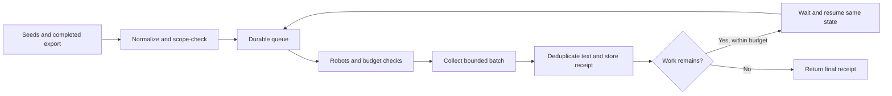

# Continue a source collection job without starting over

A collection process needs more than a request loop. It needs to remember what it has seen, stay inside its permitted scope and stop when its budget runs out. This package includes that state in a local Python service, with an n8n workflow to request the next bounded batch.

## Run the complete offline example

From the [cloned library](README.md), with Python 3.12 or later:

```sh
python3 walkthroughs/run-collector-demo.py
```

The script takes about ten seconds. It uses the real collector CLI and fixed in-memory pages. No public website is contacted, no paid discovery runs and no provider credential is needed. Its temporary state is private and is removed when the script ends.

Watch these steps in the terminal:

1. A completed **synthetic** discovery export is imported. Two in-scope input rows are accepted and one out-of-scope row is rejected. The two accepted rows normalize to the same URL, so they do not create two queue entries.
2. The same export is imported again. Its receipt says `replay: true`.
3. Each tick runs in a new Python process using the same SQLite file. The queue continues from its previous state and respects the returned wait time.
4. The final summary contains three collected URLs, two unique document bodies and four requests including the robots policy. One URL was blocked by robots.
5. One final repeated tick returns the same terminal receipt. The demo then removes its state.

These are observed results for the fictional site, not a speed benchmark or production crawl result.

## Read the counts together

| Count | Interpretation |
|---|---|
| Three collected page URLs | Three URLs yielded retained document records. |
| Two unique document bodies | One page duplicated another page's extracted content. |
| Four requests | Includes the robots request, not just pages. |
| One robots-blocked URL | A discovered URL was deliberately not fetched. |
| `complete` | The bounded queue finished. It does not mean every page on a real site was collected. |



## Move to n8n or a real source

The [package guide](../public-source-collector/README.md) explains the self-hosted service, loopback network arrangement and credential setup. The supplied n8n controller receives aggregate receipts, not document bodies. The CLI demonstration above does not execute that n8n controller.

For real collection, configure exact permitted HTTPS origins and paths, review retention and rights, and explicitly enable live mode. The service does not render JavaScript, log in, bypass paywalls, collect contact lists or send outreach. Do not delete its state to hide an uncertain response or reset a budget.

Use the [cited editorial walkthrough](cited-editorial-packet.md) for the next review step. Connecting collected documents to it requires an explicit reviewed mapping; this package does not automatically turn collected pages into publishable articles.

For help placing a collection service inside your existing process, see [Benian's n8n implementation approach](https://benian.ai/integrations/n8n-automation?utm_source=github&utm_medium=referral&utm_campaign=automation_templates&utm_content=collector_walkthrough).
